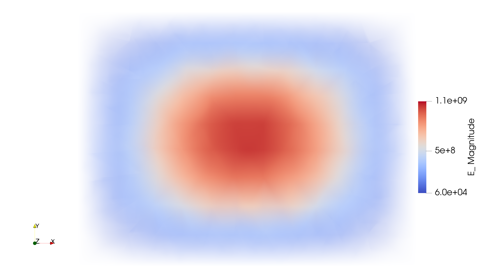
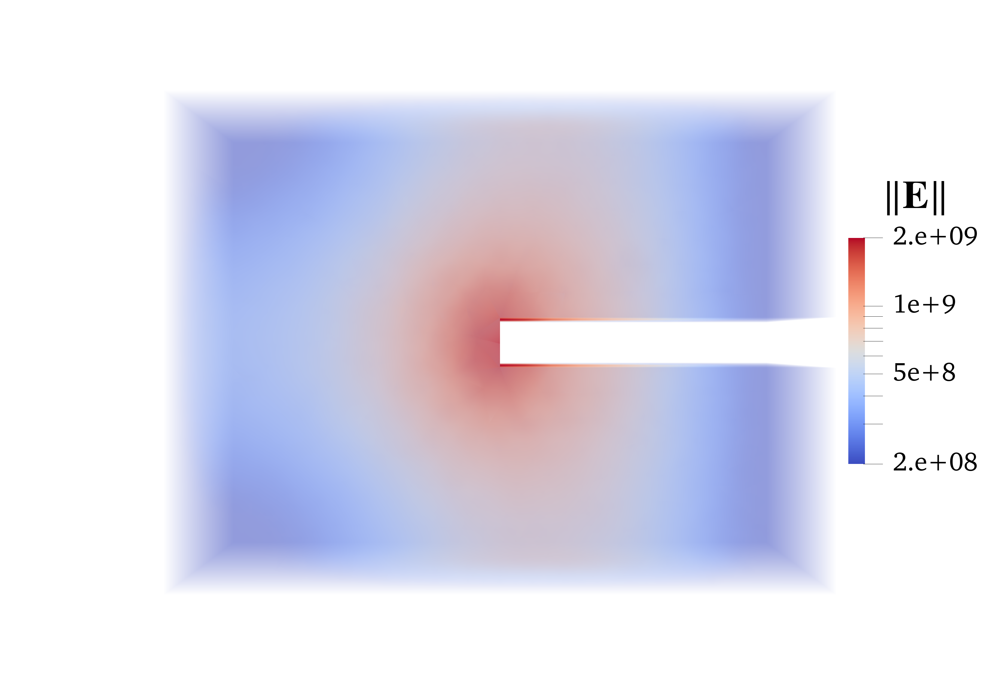
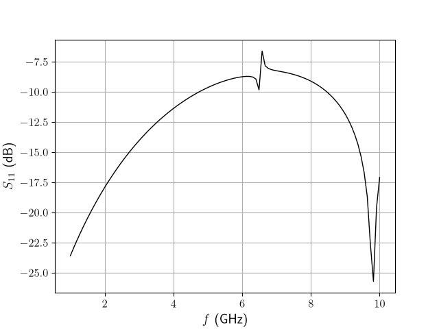
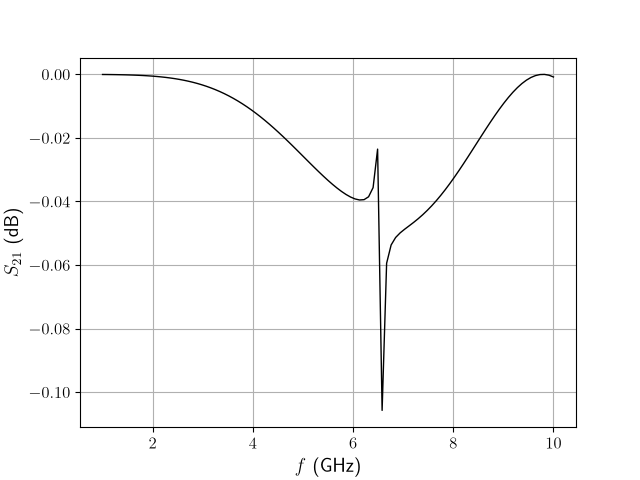
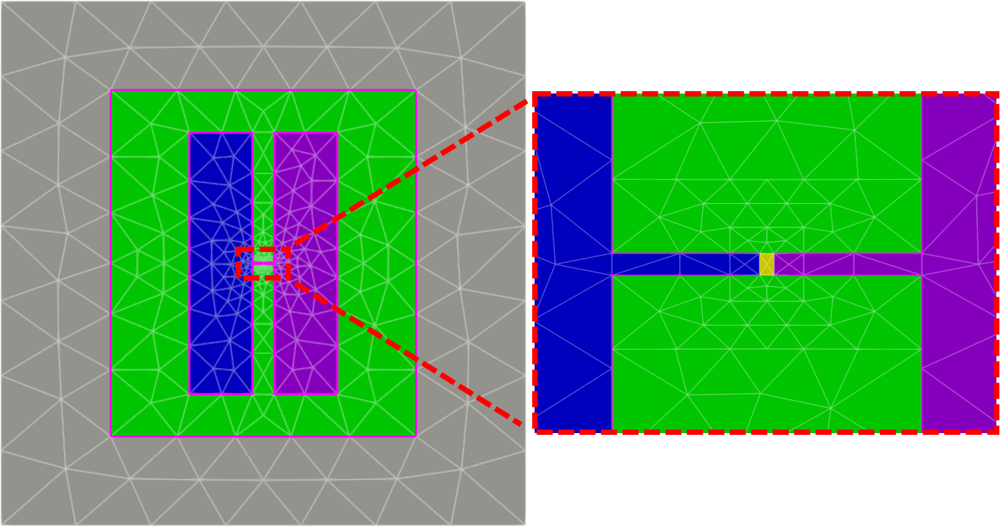
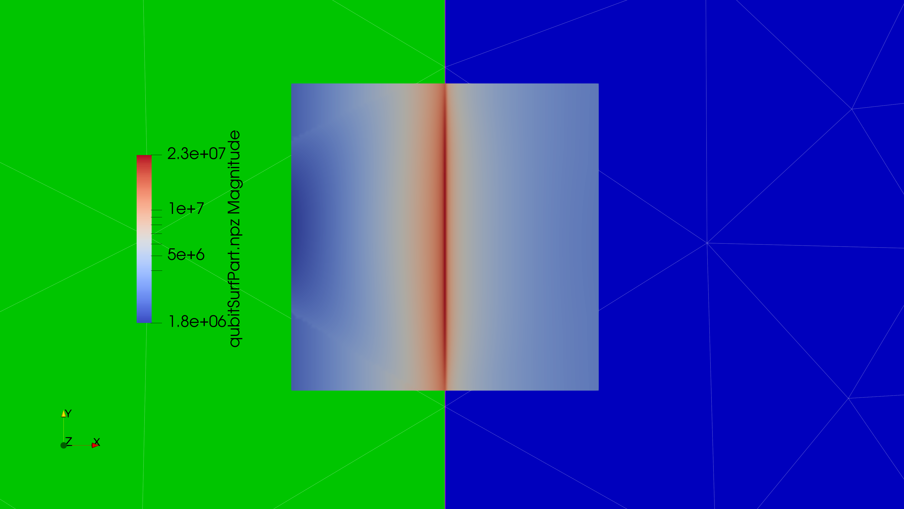

# singEM: A Singularity-Enriched Finite Element Solver for Electromagnetics

This document is intended to provide a basic overview of the features of the singEM package. This pacakge is primarily intended for performing electromagnetic (EM) simulations of microwave circuitry using the finite element method (FEM), with a particular emphasis on superconducting qubit geometries. To extract critical quantities such as participation ratios for these devices accurately and efficiently, this package uses specialized singular-field enrichment functions (also referred to as singular basis functions) to model singular fields near metal corners[^1]. When combined with optimization techniques such as Bayesian optimization (BO), this technique can be used to rapidly design qubits targeting enhanced coherence times while satisfying various constraints (e.g., qubit capacitance) at relatively low computational cost.

This document will use examples to demonstrate how simulations can be configured in this package, and how the outputs can be post-processed to obtain useful figures of merit and plots of the underlying fields.
# Environment Setup

### Windows

Simulations using this package can be run locally on Windows systems, but they will not be able to access efficient parallel solvers provided by the [PETSc package](https://petsc.org/release/). To set up an anaconda environment to use the package on Windows, you can run the following command in a terminal with [Anaconda](https://www.anaconda.com/download/success?reg=skipped) activated:

``` Bash
conda env create -f ./Bash_Scripts/singEM_windows.yml
```

Once the environment is set up, you can activate it and run simulations. See the "Rectangular Cavity" example in the Examples section below for instructions on how to run a basic simulation using this environment.

This package provides support for mesh files from external software such as `.msh` files exported from [gmsh](https://gmsh.info/), and `.inp` and `.e` files exported from [Coreform Cubit](https://coreform.com/coreform-cubit/). In these examples, we will use gmsh to create and mesh each geometry, which is included in the provided Anaconda environment.

The examples will also show how [Paraview](https://www.paraview.org/) can be used to visualize simulations results. If paraview is installed, it can be connected to this package by changing the Paraview path in [pvController.py](./PV_visualization/pvController.py). The examples will expand further upon this functionality.
## Linux (Cluster)


Most applications of this package will require using a distributed computing cluster. This section will assume that users have some basic background with cluster usage, and will assume that the cluster is using SLURM for job scheduling. Similarly to the above, the user should run the following command within a job:

``` Bash
conda env create -f ./Bash_Scripts/singEM_linux.yml
```

An example job file is included in [envSetup_linux.sh](./Bash_Scripts/envSetup_linux.sh) (note: you may need to run `dos2unix ./Bash_Scripts/envSetup_linux.sh` prior to submitting this job file). Once the environment is set up, successive jobs can simply activate the environment prior to running main.py from this package. More details on simulation configuration will be provided in the examples below.
 

#  Examples

In the following examples, we walk through the steps to set up simulations of various electromagnetic geometries and analyze their outputs.

## Rectangular Cavity (Basic Eigenmode Simulation)

We first look at an example of how to extract the eigenmodes of a simple rectangular cavity using SciPy to solve the system of equations generated using FEM. This example can be performed locally on a Windows machine or on a cluster, but we will assume it is being done locally. Subsequent examples will use PETSc for more efficient solutions.

Before running the simulation, we need to draw a geometry, mesh it, and assign material properties and boundary conditions to the volumes and surfaces. The geometry creation and meshing for this example is performed in [meshRecCavity_gmsh.py](./Meshes/Cavities/meshRecCavity_gmsh.py), which can be referenced for more details on basic geometry creation and mesh generation. Within this file, we also create a set of "blocks" to identify the volumes and surfaces with unique material properties and boundary conditions. We include the snippet for performing the block assignment below:
```Python
blockCnt = 1
phys=gmsh.model.addPhysicalGroup(3, [cav_vol], blockCnt) # Block for the cavity volume
gmsh.model.setPhysicalName(3, phys, "mpr1epr1") # 3 is the dimension (3D volume), mpr1epr1 is the name

blockCnt += 1
phys=gmsh.model.addPhysicalGroup(2, cav_surfs, tag=blockCnt) # Outer boundary block
gmsh.model.setPhysicalName(2, phys, "Outer") # 2 is the dimension (2D surfaces), Outer is the name
```

Here we have 2 blocks: block 1 containing all tetrahedrons forming the volume of the cavity (`cav_vol`), and block 2 with all triangles forming the outer surfaces of the cavity (`cav_surfs`). To assign properties to these blocks, we use a geometry configuration file, which in this case is [recCavity.json](./Meshes/Cavities/recCavity.json). This file is included below with comments to show how these assignments are formatted:

```Python
{
  "scale": 1, # Scaling applied to the dimensions used in the mesh 
              # If the mesh is defined in mm, this should be set to 1e-3
  "volP": { # Parameters of volume blocks
    "num": 1, # Number of volume blocks
    "vol0": { # Properties of volume block 0
      "epr": 1.0, # Relative permittivity
      "mur": 1.0, # Relative permeability
      "sigma": 0.0, # Conductivity
      "tanD": 0.0 # Loss tangent
    }
  },
  "surfP": { # Parameters of surface blocks
    "num": 1, # Number of surface blocks
    "surf0": {
      "type": "Outer" # Type of boundary condition (outer = outer boundary, which is mapped to PEC)
    }
  }
}
```
For the volume block, we specify material properties such as permittivity and permeability. For the surface, in this case we just mark this block as being the outer boundary. In this version of the package, the outer boundary is always treated as a perfect electric conductor (PEC), but later versions may add support for additional boundary conditions. Note that more detailed documentation on the types of blocks and their available settings can be found in the docstring of `writeGeometryJSON()` in [JSON_util.py](./JSON_util.py). Examples of more complicated block definitions such as ports and singular lines will also be included in later examples.

FEM simulations are performed by running [main.py](./main.py) with the flag `-f` pointing to a simulation configuration file, which specifies settings of the simulation itself. The configuration file used for this example is [cavity_Eig.json](./Meshes/Cavities/cavity_Eig.json). The contents of the file are included below, with comments indicating what each setting does:

```Python
{
  "probP": { # Problem parameters
    "type": "Eig", # The type of problem to solve ("Eig" for eigenmode, "FD" for driven frequency domain)
    "numEig": 5, # Number of eigenmodes to evaluate
    "geomFile": "./Meshes/Cavities/recCavity.json", # Path to a "geometry configuration file" containing 
                                                    # material properties and boundary conditions
    "meshFile": "./Meshes/Cavities/recCavity.msh", # Path to the mesh file exported from a meshing tool 
                                                   # (gmsh or Cubit)
    "bOrder": 1 # Order of the basis functions (can be 1 or 2)
  },
  "solveP": { # Solver parameters
    "pkg": "SciPy", # Package used to perform the solve (either "SciPy" or "SLEPc" for eigenvalues)
    "shift": 20e9, # Value (in Hz) to look for eigenvalues near
    "tol": 1e-06 # Desired tolerance for the eigenvalues
  },
  "outP": { # Output parameters
    "resFile": "./Results/recCavity_p=1.npz", # File to save the results in (must be .npz)
    "saveFields": true, # Flag indicating whether to plot the eigenvectors in all elements 
    "fieldType": "E", # Which field to plot if "saveFields" == True
    "fFile": "fields.npy" # File containing field information for eigenvectors
  },
  "numProcs": 1 # Number of parallel processes to run the simulation with (1 = serial)
}
```
Note that a complete list of settings can be found in the docstring of `writeSimJSON()` in [JSON_util.py](./JSON_util.py). 

Once the settings are configured, the simulation can be ran using the following command:

```Bash
python main.py -f "./Meshes/Cavities/cavity_Eig.json"
```

The results will print out in the terminal, and should look similar to the following:

```
Time spent forming element lists: 0.343 s
Number of tetrahdrons: 3106
Number of wedges: 0
Number of nodes: 308
Number of edges: 2987
Number of triangular faces: 5784
Number of quadrilateral faces: 0
Longest triangular edge: 1.906e+00 mm
Shortest triangular edge: 7.381e-01 mm
Average triangular edge length: 1.176e+00 mm
Triangular edge length standard deviation: 2.627e-01 mm
Time spent building basis maps: 0.006 s. Element order: 1. Singular element order: 1 Total number of unknowns: 2987
Beginning matrix assembly
Matrix assembly done, time elapsed = 9.196 s
Finding eigenvalues
5 eigenvalues found in 0.115 s.
Eigenvalue 0: 24.55098+0.00000j GHz
Eigenvalue 1: 32.42135+0.00000j GHz
Eigenvalue 2: 35.28165+0.00000j GHz
Eigenvalue 3: 35.36425+0.00000j GHz
Eigenvalue 4: 37.98527+0.00000j GHz
Total run time: 11.963 s
```

After providing some diagnostic and timing information, the requested eigenvalues are printed. If the code is configured to connect to Paraview (see Windows Environment Setup above)
and `"saveFields" == true` in [cavity_Eig.json](./Meshes/Cavities/cavity_Eig.json), Paraview will open and allow the user to visualize the fields throughout the cavity. Note that this plotting method only allows a single value to be provided for each mesh element, so the resolution will be relatively poor for coarse meshes like this one. More sophisticated plotting approaches will be discussed in later examples to overcome this issue.

When Paraview initially opens, the center view may be blank. The geometry can be plotted by clicking the closed eye icon in the "Pipeline Browser" (which may need to be added via the View tab). To plot the field distribution throughout the geometry, the "coloring" drop-down in the "Properties" menu should be set to "E_" (which can be tuned to plot the magnitude or any vector component). If there are surface blocks, these need to be unchecked in the "Element Blocks" section of the "Properties" menu to ensure only data associated with the tetrahedrons is included. By changing the display representation in that menu to "Volume," we can generate images such as the one below. Note that we have also applied the `CellDatatoPointData` filter in Paraview to smooth out the plot.



For eigenmode problems, field plots for the other modes can also be loaded into paraview. These can be accessed by opening the "Time Manager" window from the View menu and changing the timestep. The view can also be modified further by applying filters such as cutting planes and thresholding functions. More details about these settings can be found in the [Paraview User's Guide](https://docs.paraview.org/en/latest/UsersGuide/index.html).

## Ridged Waveguide Cavity (Singular Eigenmode Simulation)

Next, we consider another eigenmode problem in the form of a ridged waveguide cavity. As shown in the plot below, the dominant eigenmode of this cavity is singular with respect to the edges of the ridge.



In order to resolve this mode accurately with a coarse mesh, we include singular basis functions in the tetrahedrons contacting this metal edge. To accomodate these singular edges in the mesh, we add another block containing the set of mesh edges along the singular features in the mesh file [meshRidgedCavity_gmsh.py](./Meshes/Cavities/meshRidgedCavity_gmsh.py). The excerpt of this script creating the blocks is included below:

```Python
## Make Blocks
blockCnt = 1
phys=gmsh.model.addPhysicalGroup(3, [cav_vol], blockCnt) # Block for the cavity volume
gmsh.model.setPhysicalName(3, phys, "mpr1epr1") # 3 is the dimension (3D volume), mpr1epr1 is the name

blockCnt += 1
phys=gmsh.model.addPhysicalGroup(2, cav_surfs, tag=blockCnt) # Outer boundary block
gmsh.model.setPhysicalName(2, phys, "Outer") # 2 is the dimension (2D surfaces), Outer is the name

blockCnt += 1
phys=gmsh.model.addPhysicalGroup(1, singLines, tag=blockCnt) # Singular line block
gmsh.model.setPhysicalName(1, phys, "singLines") # 1 is the dimension (1D edges), singLines is the name
```

Then within the geometry file [ridgedCavity_sing.json](./Meshes/Cavities/ridgedCavity_sing.json), we mark this block as being a set of singular lines and assign the coefficient describing the singular behavior:
```Python
{
  "scale": 1,
  "volP": {
    "num": 1,
    "vol0": {
      "epr": 1.0,
      "mur": 1.0,
      "sigma": 0.0,
      "tanD": 0.0
    }
  },
  "surfP": {
    "num": 1,
    "surf0": {
      "type": "Outer"
    }
  },
  "lineP": { # Parameters of line blocks
    "num": 1, # Number of line blocks
    "line0": {
      "type": "singLine", # Marks that singular basis functions should be added
                          # to tets touching nodes or edges along this line
      "coeff": 0.667 # Coefficient of the singularity (2/3 for 90 degree metal wedges)
    }
  }
}

```
In the current version of the code, integrals of the singular basis functions are pre-calculated for a unit tetrahedron and rescaled to the dimensions of each tetrahedron in the mesh[^1]. This step has been performed in advance for coefficients of 1/2 and 2/3 to match the expected behavior near metal wedges at 0 and 90 degree angles respectively [^2], and the resulting integrals are stored in [BasisMats](./BasisMats/). If alternative coefficients are needed, additional files can be generated using [singBasisMats_tets_numeric.py](singBasisMats_tets_numeric.py).

In the simulation file [ridgedCavity_Eig.json](./Meshes/Cavities/ridgedCavity_Eig.json), we add another setting to specify the singular basis function order:

```Python
{
  "probP": {
    "type": "Eig",
    "numEig": 5,
    "geomFile": "./Meshes/Cavities/ridgedCavity_sing.json",
    "meshFile": "./Meshes/Cavities/ridgedCavity.msh",
    "bOrder": 1,
    "sOrder": 1 # Order of singular basis functions
  },
  "solveP": {
    "pkg": "SciPy",
    "shift": 20e9,
    "tol": 1e-06
  },
  "outP": {
    "resFile": "./Results/ridgedCavity_p=1,s=1.npz",
    "saveFields": true,
    "fieldType": "E",
    "fFile": "fields.npy"
  },
  "numProcs": 1
}
```

Once again, we can run the simulation as configured above using

```Bash
python main.py -f "./Meshes/Cavities/cavity_Eig.json"
```

For eigenvalue 0, the singular basis functions give an eigenvalue of `31.02635 GHz`, giving a percent error of `2.32%` relative to the value of `31.76373 GHz` obtained using 2nd order functions on a dense mesh. If we remove the singular basis functions by changing "geomFile" in [ridgedCavity_Eig.json](./Meshes/Cavities/ridgedCavity_Eig.json), the resulting eigenvalue is `30.34435 GHz`, meaning the percent error is increased to `4.47%`. A more detailed comparison of the performance can be found in our publication on the singular functions [^1].

## Microstrip (Driven Simulation)

Here, we demonstrate how to perform a driven simulation using a microstrip transmission line as an example. In this case, we set up the problem on a computing cluster and use PETSc to evaluate the linear system produced by the FEM code. The configuration file for this simulation is [microstrip_FD.json](./Meshes/Microstrip/microstrip_FD.json), and the settings are included below:

```Python
{
  "probP": {
    "type": "FD", # Problem type is frequency domain (driven)
    "minFreq": 1e9, # Minimum frequency to solve at is 1 GHz
    "maxFreq": 10e9, # Maximum frequency to solve at is 10 GHz
    "numSteps": 101, # Number of frequency steps between the minimum and maximum
    "stepType": "linear", # Type of spacing between steps (either "linear" or "log")
    "geomFile": "./Meshes/Microstrips/microstrip.json",
    "meshFile": "./Meshes/Microstrips/microstrip.msh", 
    "outBC": "PEC",
    "bOrder": 2, # Using 2nd order basis functions for higher accuracy   
    "portMatrix": false # Flag indicating whether to simulate driving from all ports (true)
                        # or from only a single port (false). If false, uses settings from the geometry file
  },
     
  "solveP": {
    "pkg": "PETSc" # Using a solver from PETSc rather than SciPy
  },  
  "outP": {
    "saveV": true,
    "saveS": true,
    "resFile": "./Results/microstrip.npz"
  },
  "numProcs": 32 # Solve using 32 parallel processes (job must request 32 cores)
}
```
This configuration will perform simulations at 101 linearly-spaced frequency steps between 1 and 10 GHz. The code is set up to use solution-space projection to interpolate solutions at a smaller subset of frequencies to this full set, so using a large number of points will not require an excessively long simulation.

The mesh file [microstrip.msh]("./Meshes/Microstrips/microstrip.msh") contains several blocks, including two blocks for the volume, and five surface blocks. The surface blocks include one for the outer boundary, two PEC blocks for the signal trace and ground plane, and two blocks for the ports used to drive and terminate the geometry. The file is included with comments below to demonstrate how these blocks are specified:

```Python
{
  "scale": 1,
  "volP": {
    "num": 2, # Number of volume blocks
    "vol0": { # Parameters of the substrate block
      "epr": 7.0, # Relative permittivity of the substrate
      "mur": 1.0,
      "sigma": 0.0,
      "tanD": 0.0
    },
    "vol1": { # Parameters of the free-space block
      "epr": 1.0, # Relative permittivity of free-space
      "mur": 1.0,
      "sigma": 0.0,
      "tanD": 0.0
    }
  },
  "surfP": {
    "num": 5, # Number of surface blocks
    "surf0": {
      "type": "Outer" # Outer boundary
    }, 
    "surf1": {
      "type": "PEC" # Signal trace
    }, 
    "surf2": {
      "type": "PEC" # Ground plane
    }, 
    "surf3": {
      "type": "Port", # Input port
      "Z": 50, # Port impedance (only used if portType != "open") 
      "portType": "Open", # Marks whetehr her the port is open-circuited ("Open") or resistive ("R")
                          # Inductive ("L") or capacitive ("C") ports are also available options.
                          # In these cases, "Z" gives the inductance or capacitance itself, and frequency 
                          # scaling is applied internally
      "width": 0.001, # Width of the port as defined in the mesh file
      "direction": [ # Unit vector describing the direction of the port
        0.0, 
        1.0,
        0.0
      ],
      "normal": [ # Unit vector describing the direction normal to the port
        0.0, 
        0.0,
        1.0
      ],
      "Vsmag": 1.0 # Magnitude of the voltage being sourced to this port. 
                   # If portType == "open", this value is interpreted as the magnitude of the current source.      
    },
    "surf4": { 
      "type": "Port", # Output port
      "Z": 50,
      "portType": "Open",
      "width": 0.001,
      "direction": [
        0.0,
        1.0,
        0.0
      ],
      "normal": [
        0.0,
        0.0,
        1.0
      ],
      "Vsmag": 0.0
    }
  }
}
```

Because this job is configured to use PETSc to solve the linear system, it must be ran on a cluster or another linux system with petsc4py available (such as through the provided environment file, see Environment Setup above). If run on a cluster, the job should request at least 32 cores to match the "numProcs" setting in [microstrip_FD.json](./Meshes/Microstrip/microstrip_FD.json) above (or this setting can be changed). Within the job, the simulation is ran via

```Bash
python main.py -f "./Meshes/Microstrip/microstrip_FD.json"
```

In addition to the output file produced by the job, the outputs of the simulation are stored in "./Results/microstrip.npz" as specified by "resFile" in [microstrip_FD.json](./Meshes/Microstrip/microstrip_FD.json). We've included a script to demonstrate how these results can be plotted in [microstripPlots.py](./Plotting/microstripPlots.py). Running this script after the simulation will generate the following plots of the S-parameters of this device:






## Superconducting Qubit (Singular Driven Simulation)
We now examine a simulation where we use singular basis functions to accurately extract participation ratios for thin interface layers using a coarse mesh. The mesh used for this simulation is [qubit_10umTrench.msh](./Meshes/Qubit/qubit_10umTrench.msh), which is generated using [meshQubit_gmsh.py](./Meshes/Qubit/meshQubit_gmsh.py). To visualize this mesh in Paraview, we first convert to an Exodus file using the following command:

```Bash
python .\gmshToExo.py -g ".\Meshes\Qubit\qubit_10umTrench.msh" -e ".\Meshes\Qubit\qubit_10umTrench.e"
```

The resulting Exodus file can then be loaded into Paraview and visualized. We plot a cross section of this mesh with each of its blocks false-colored below. Note that the interface layers are NOT included as volumes in this mesh, and are instead represented as surfaces on the metal and substrate. The properties of each layer (such as height and permittivity) are described in the geometry configuration file to incorporate their effects.



Below, we provide a commented version of the geometry configuration file [qubitSurfPart.json](./Meshes/Qubit/qubitSurfPart.json). In the comments, the color of each block in the above image is provided in parentheses:

```Python
{
  "scale": 1e-3, # The mesh is defined in mm, so it needs to be rescaled
  "volP": {
    "num": 2, # Volume blocks for the substrate and free space
    "vol0": { # Substrate (green)
      "epr": 11.45,
      "mur": 1.0,
      "sigma": 0.0,
      "tanD": 0.0
    },
    "vol1": { # Free space (not pictured)
      "epr": 1.0,
      "mur": 1.0,
      "sigma": 0.0,
      "tanD": 0.0
    }
  },
  "surfP": {
    "num": 14,
    "surf0": { # Outer boundary, which is connected to the ground plane (gray)
      "type": "Outer"
    },
    "surf1": { # Left pad (blue)
      "type": "PEC"
    },
    "surf2": { # Right pad (purple)
      "type": "PEC" 
    },
    "surf3": { # Josephson junction, treated as a port to drive the geometry (yellow)
      "type": "Port",
      "Z": 50,
      "portType": "Open",
      "width": 0.00292,
      "direction": [
        1.0,
        0.0,
        0.0
      ],
      "normal": [
        0.0,
        0.0,
        1.0
      ],
      "Vsmag": 1.0
    },
    "surf4": { # Metal-air interface on the top of the ground plane (gray)
      "type": "Output", # Indicates that this block is for specifying an output quantity
      "fieldType": "surfPart", # The desired output quantity is the surface participation
      "thickness": 3e-6, # Thickness of the interface layer associated with this surface (which is NOT)
      "vol": 1, # Which volume block this interface layer would lie in. Since this is the metal-air interface, 
                # it would sit on the free-space side (in vol1)
      "epr": 5.0 # Permittivity of the interface layer
    },
    "surf5": { # Metal-air interface on the top of the left pad (blue)
      "type": "Output",
      "fieldType": "surfPart",
      "thickness": 3e-6,
      "vol": 1,
      "epr": 5.0
    },
    "surf6": { # Metal-air interface on the top of the right pad (purple)
      "type": "Output",
      "fieldType": "surfPart",
      "thickness": 3e-6,
      "vol": 1,
      "epr": 5.0
    },
    "surf7": { # Metal-air interface on the sides of the ground plane (gray)
      "type": "Output",
      "fieldType": "surfPart",
      "thickness": 3e-6,
      "vol": 1,
      "epr": 5.0
    },
    "surf8": { # Metal-air interface on the sides of the left pad (blue)
      "type": "Output",
      "fieldType": "surfPart",
      "thickness": 3e-6,
      "vol": 1,
      "epr": 5.0
    },
    "surf9": { # Metal-air interface on the sides of the right pad (purple)
      "type": "Output",
      "fieldType": "surfPart",
      "thickness": 3e-6,
      "vol": 1,
      "epr": 5.0
    },
    "surf10": { # Metal-substrate interface below the ground plane (gray)
      "type": "Output",
      "fieldType": "surfPart",
      "thickness": 3e-6,
      "vol": 0, # Since this is the metal-substrate interface, it would instead lie in vol0
      "epr": 5.0
    },
    "surf11": { # Metal-substrate interface below the left plane (blue)
      "type": "Output",
      "fieldType": "surfPart",
      "thickness": 3e-6,
      "vol": 0,
      "epr": 5.0
    },
    "surf12": { # Metal-substrate interface below the right plane (purple)
      "type": "Output",
      "fieldType": "surfPart",
      "thickness": 3e-6,
      "vol": 0,
      "epr": 5.0
    },
    "surf13": { # Substrate-air interface (green)
      "type": "Output",
      "fieldType": "surfPart",
      "thickness": 3e-6,
      "vol": 1,
      "epr": 5.0
    }
  },
  "lineP": {
    "num": 1,
    "line0": { # Singular lines (highlighted in pink)
      "type": "singLine", 
      "coeff": 0.667
    }
  }
}
```
In the mesh file, all conductive edges at 90 degree angles are marked as singular (and thus included in the line block). However, we add a 1 um gap between the port and the singular lines, as the singular basis functions do not function well when included on triangles along the port surface.

Once the geometry settings are specified, the simulation can be configured in [qubit_FD.json](./Meshes/Qubit/qubit_FD.json). These settings are also included below with comments. 

```Python
{
  "probP": {
    "type": "FD",
    "minFreq": 5e9,
    "maxFreq": 5e9,
    "numSteps": 1, # Perform a single solve at 5 GHz to get the participation ratios there
    "stepType": "linear",
    "geomFile": "./Meshes/Qubit/qubitSurfPart.json",
    "meshFile": "./Meshes/Qubit/qubit_10umTrench.msh",
    "bOrder": 2,
    "sOrder": 3 # Using 3rd order singular functions for improved accuracy
  },
  "solveP": {
    "pkg": "PETSc" # Using PETSc to solve the linear system
  },
  "outP": {
    "saveV": true,
    "saveS": false,
    "resFile": "./Results/qubitSurfPart.npz",
    "fieldPoints": "./Meshes/Qubit/EvalPts/qubitEvalPoints_topEdge.npy" # Saving field values at a pre-selected set of points for plotting purposes
  },
  "numProcs": 32
}
```
In the output parameters above, we include "fieldPoints," which points to a .npy file containing coordinates for a set of points we wish to evaluate the electric field at. An example of how to generate this file is provided in [qubitEvalPoints_rectangle.py](./Meshes/Qubit/EvalPts/qubitEvalPoints_rectangle.py). Later, we will show how the evaluations at these points can be used to plot the corresponding behavior in Paraview. A similar process can also be used to evaluate fields along lines near the singular edges and analyze the singular behavior using a 1D plot[^1]. 

Once again, we run the simulation within a job by pointing to the configuration file with the following command:
```Bash
python main.py -f "./Meshes/Qubit/qubit_FD.json"
```

Because the geometry file above marks some of the surface blocks as output surfaces with participation ratio calculations associated with them, the output file will contain these ratios. Below, we include the participation ratios for this geometry, where the surfaces are numbered to match the ordering in [qubitSurfPart.json](./Meshes/Qubit/qubitSurfPart.json). In the output below, we comment in the labelings for each surface for clarity:
```Bash
Current frequency: 5.00000 GHz
Voltage at port 0: 0.00000+527.91179j V
Output surface 0 surfPart integral: 2.01404e-08+0.00000e+00j # Top ground MA
Output surface 1 surfPart integral: 8.08471e-07+0.00000e+00j # Top left pad MA
Output surface 2 surfPart integral: 8.39604e-07+0.00000e+00j # Top right pad MA
Output surface 3 surfPart integral: 2.47962e-10+0.00000e+00j # Side ground MA
Output surface 4 surfPart integral: 3.02013e-08+0.00000e+00j # Side left pad MA
Output surface 5 surfPart integral: 3.05606e-08+0.00000e+00j # Side right pad MA
Output surface 6 surfPart integral: 2.22659e-06+0.00000e+00j # Ground MS
Output surface 7 surfPart integral: 7.00609e-05+0.00000e+00j # Left pad MS
Output surface 8 surfPart integral: 6.95410e-05+0.00000e+00j # Right pad MS
Output surface 9 surfPart integral: 3.69139e-05+0.00000e+00j # SA
```
Note that this mesh is different than that used in our publication on the singular functions[^1], so the results are slightly different.

To visually demonstrate the effectiveness of the singular basis functions, we can import the plotting points from the "fieldPoints" file provided in [qubit_FD.json](./Meshes/Qubit/qubit_FD.json) into Paraview. To do this, we first convert the set of points and field values into a .vtk file, which can be done using the provided [singularityPlot_2D_paraview.py](./Plotting/singularityPlot_2D_paraview.py) script. We can load the .vtk file output by this script into Paraview and plot the field distribution in this region over the mesh, where singular behavior is clearly being captured by the singular basis functions.




[^1]: [Elkin, S. T., Khan, G., Forati, E., Langley, B. W., Timucin, D., Molavi, R., & Roth, T. E. (2026). Singular Vector Finite Element Basis Functions for Tetrahedra in Complex Electromagnetic Geometries. arXiv preprint arXiv:2606.18140.](https://arxiv.org/abs/2606.18140)

[^2]: Jackson, J. D. (1998). Classical Electrodynamics. John Wiley & Sons.

#
